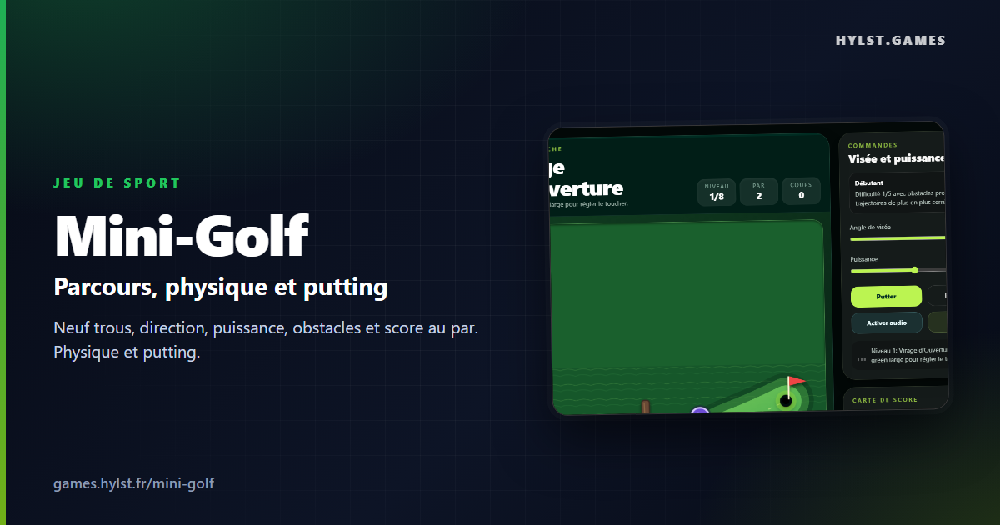

# Mini-Golf

**Huit trous, direction, puissance et score au par.**

Mini-Golf propose huit trous de difficulté progressive, du green large au parcours à portes mobiles. Réglez l'angle de visée et la puissance, puis puttez : la balle roule, rebondit sur les rails, ralentit dans le sable et tombe dans l'eau avec un coup de pénalité. La carte de score suit les coups, le par et le résultat trou par trou ; le total au par donne la performance de la partie. Sons synthétisés dans le navigateur, plein écran et commandes tactiles.

Joue ici : [games.hylst.fr/mini-golf/](https://games.hylst.fr/mini-golf/)



## Fonctionnalités

- Huit trous avec par, obstacles, sable, eau, rails et portes mobiles.
- Angle de visée et puissance réglables, putter et replacement.
- Carte de score trou par trou et total au par.
- Difficulté progressive, plein écran, commandes tactiles.
- Sons synthétisés avec Web Audio.
- Aucune donnée locale, aucun compte, aucun cookie.

## Technique

- React 19, TypeScript, Vite 7 et Tailwind CSS 4.
- Build en un fichier `index.html`.
- Parcours et balle en SVG, aucune image externe.

```bash
npm ci
npm run build
```

Le build sort dans `dist/`. Il se sert sous `/mini-golf/`.

## Structure

```
src/App.tsx     parcours, balle, visée, puissance et score
src/index.css   thème et animations
```

## Licence

AGPL-3.0-or-later. Voir `LICENSE`.

Jeu créé par Geoffroy (Hylst) avec l'aide d'une IA.
